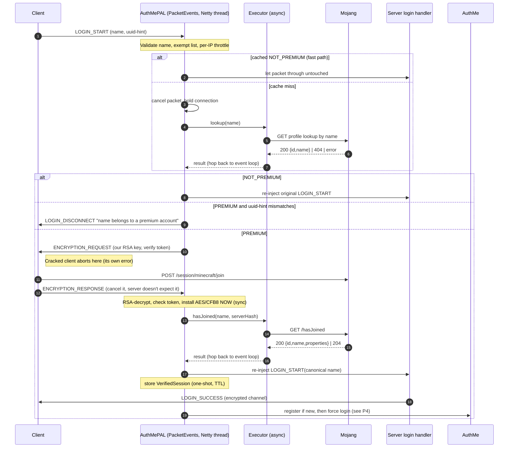

# Agent Instructions for Token Optimization & Resource Management

## 1. Context & Scope Limitation (CRITICAL)
- **Never scan the entire project directory** or attach unnecessary files automatically. 
- Only read, index, or analyze the **specific file or files** explicitly requested or relevant to the current task.
- Avoid reading build outputs, dependency folders, or compiled caches (e.g., `build/`, `.gradle/`, `.idea/`, `*.jar`).

## 2. Iterative Task Execution
- Break down coding requests into **single-file, bite-sized tasks**. 
- Do not attempt to refactor multiple unrelated classes or packages in a single tool call unless absolutely required.
- If an error occurs (such as a Gradle build failure), read only the relevant stack trace snippet rather than dumping whole configuration logs.

## 3. Environment Context
- Target Platform: Minecraft Java Plugin development using **Paper API / Leaf v26.3**.
- Keep all code lightweight, optimized for low-spec hosting servers, and compliant with modern Java standards. 

---

# Implementation Plan

> Hand-off document for a coding agent. Project name: **login-core** (repo name; runtime plugin name is still `AuthMePAL`; flip to `AuthMe` deferred to the vendoring commit — see `docs/DEVIATIONS.md`)
> Last researched: 19 Oct 2026. Items tagged **[VERIFY]** are assumptions I could not confirm from documentation. Verify them in Phase 0 before building on them.
> **Status updated: 22 Oct 2026.** The plan below is the original hand-off document; §15 records what was actually built, what is stale in the plan text, and the full defect/edge-case audit. Where they disagree, §15 wins.

---

## 0. Ground rules for the agent
1. **Spikes first.** Do M0 and M1 before anything else. If a spike result contradicts this plan, **stop and report** using the template in §12. Do not invent a workaround silently.
2. **Verify APIs against javadocs/source, not memory.** Class and method names in this plan are best knowledge. Sources: <https://javadocs.packetevents.com>, <https://docs.packetevents.com>, <https://jd.papermc.io/paper>, AuthMe's source/javadocs.
3. **Fail closed on identity.** Any doubt about "is this really the premium owner?" means the player is **not** auto-logged-in.
4. **Never block a Netty event-loop thread** (no HTTP, no DB, no `Future.get()` there). Hop to an executor, then hop back with `channel.eventLoop().execute(...)`.
5. **Never log secrets** (shared secret, verify token, private key, session tokens).
6. Keep a running `docs/DEVIATIONS.md`: anything you did differently from this plan, and why.
7. Small commits, one milestone per branch, tests green before moving on.

---

## 1. Goal and scope

### Required behaviour
| # | Requirement |
|---|---|
| R1 | Hook into AuthMeReloaded (6.0.1+). |
| R2 | Detect automatically whether a connecting username belongs to a premium (Mojang) account. If the client proves ownership, log them in without a password, **as if the server had never been offline-mode**. |
| R3 | If a **cracked** client connects with a **premium username**, deny the join with a message telling them to change their username. |
| R4 | Use **PacketEvents** (not ProtocolLib). |
| R5 | One-time migration path for already-registered accounts. |

### Non-goals (v1): do not build these
BungeeCord/Velocity, Folia, Bedrock/Floodgate, any auth plugin other than AuthMe, PlaceholderAPI, MySQL/other DB backends, translations/locale files, self-service `/premium` and `/cracked` commands, automatic migration of existing UUID-keyed player data.

### Why this plugin still exists next to AuthMe 6's own premium bypass
AuthMe 6 has a built-in PacketEvents premium bypass, but it is **opt-in** (`/premium` after logging in with a password) and doesn't stop cracked clients from using premium names. AuthMePAL automates both. **AuthMe's `settings.enablePremium` must stay `false`**, otherwise two plugins would both try to run the encryption handshake on the same connection (see P9).

---

## 2. Target environment and pinned versions

| Component | Version / value | Notes |
|---|---|---|
| Server | **Paper 26.3** (offline mode: `online-mode=false`) | New version scheme (no `1.x`). Plugin API dependency `io.papermc.paper:paper-api:26.3.build.200-stable`. |
| Java | **25** | Toolchain 25 (Paper's project-setup docs require Java 25 for 26.x). |
| Build | **Gradle, Kotlin DSL** (use the wrapper) | `run-paper` Gradle plugin for a local test server. |
| PacketEvents | **2.14.0** (supports Paper 26.3) | **Installed as a server plugin, not shaded** (AuthMe also expects the PacketEvents plugin). `compileOnly` + `depend`. |
| AuthMe | **6.0.1** (3 Sep 2026; lists 26.2 support) | Paper jar vs Spigot-1.21 jar: **[VERIFY]** which one the server should run on Paper 26.3 (AuthMe README says Paper jar for Paper 1.21+). |
| Plugin descriptor | `plugin.yml` | Paper's own docs flag `paper-plugin.yml` as experimental. `api-version: '26.3'`, `depend: [packetevents, AuthMe]`, plugin name `AuthMePAL`, author `hizeric`. The name/`depend` flip is deferred to the vendoring commit (`docs/DEVIATIONS.md`). |
| JSON | Gson | Provided by the server; don't shade. |
| Storage | SQLite (single file) | **[RESOLVED]** the driver does not ship with Paper; `plugin.yml` declares it under `libraries:` (`plugin.yml:8-10`). |
| HTTP | JDK `java.net.http.HttpClient` | Connect timeout 3 s, request timeout 5 s. |

### Gradle skeleton (adjust after verifying coordinates)
```kotlin
plugins {
    java
    id("xyz.jpenilla.run-paper") version "<latest>"   // [VERIFY] current version
}

repositories {
    mavenCentral()
    maven("https://repo.papermc.io/repository/maven-public/")
    maven("https://repo.codemc.io/repository/maven-releases/")    // PacketEvents
    maven("https://repo.codemc.org/repository/maven-public/")     // AuthMe  [VERIFY] 6.0.1 is published here
}

dependencies {
    compileOnly("io.papermc.paper:paper-api:26.3.build.200-stable")
    compileOnly("com.github.retrooper:packetevents-spigot:2.14.0")
    compileOnly("fr.xephi:authme-core:6.0.1")                     // [VERIFY] artifact + AuthMeApi package (api.v3?)
    testImplementation(platform("org.junit:junit-bom:<latest 5.x>"))
    testImplementation("org.junit.jupiter:junit-jupiter")
}

java { toolchain.languageVersion.set(JavaLanguageVersion.of(25)) }

tasks.runServer {
    minecraftVersion("26.3")
    // download PacketEvents + AuthMe into the run dir; write online-mode=false  [VERIFY run-paper syntax]
}
```

---

## 3. Architecture

> **As built** (verified 22 Oct 2026). The original sketch below is superseded: the package was renamed to `com.hizeric.logincore`, the `config/` package was never created (config is read directly in `LoginCore`), the listener is `PremiumLoginListener`, and the state enum is `LoginFlowState` (`docs/DEVIATIONS.md:4-5`).

```
com.hizeric.logincore
├── LoginCore.java                // JavaPlugin: wiring, worker pool, startup guards, ordered shutdown
├── mojang/
│   ├── MojangClient.java         // name->uuid lookup, hasJoined; base URLs configurable (test seam)
│   ├── LookupResult.java         // PREMIUM(uuid,canonicalName) | NOT_PREMIUM | UNKNOWN(reason)
│   ├── LookupCache.java          // positive + negative TTL cache, in-flight de-dup
│   └── RateBudget.java           // global lookup budget + per-IP throttle
├── handshake/
│   ├── PremiumLoginListener.java // PacketEvents listener + per-connection state machine (594 lines)
│   ├── LoginFlowState.java       // per-connection state enum (renamed to avoid PacketEvents collision)
│   ├── EncryptionKeys.java       // RSA-1024 keypair created at startup
│   ├── CipherInstaller.java      // installs AES/CFB8 handlers in the Netty pipeline
│   ├── LoginMetrics.java         // counters surfaced by /logincore status
│   └── ServerHash.java           // Minecraft's signed-hex SHA-1
├── decision/
│   └ LoginDecisionEngine.java    // pure logic: inputs -> Action (unit-testable, no I/O)
├── authme/
│   ├── AuthMeBridge.java         // the ONLY class that touches AuthMe types
│   └── AuthMeLoginListener.java  // AsyncPlayerPreLoginEvent @LOWEST profile + @HIGHEST AuthMe work; LoginEvent linking
├── storage/
│   └── Storage.java              // SQLite: links, exempt; single connection on one executor thread
├── session/
│   └── VerifiedSessions.java     // short-lived, one-shot, keyed by name@ip (see DEVIATIONS.md:6)
├── command/
│   └── AdminCommand.java         // /logincore status|exempt|migrate
└── migration/
    └── MigrationAudit.java
```
Rules: `LoginDecisionEngine` has **no** PacketEvents/Bukkit/AuthMe imports (honoured). `AuthMeBridge` isolates AuthMe so an API change touches one file (honoured).

**Test classes** (`src/test/java/com/hizeric/logincore/`): `ServerHashTest`, `MojangClientTest`, `LoginDecisionEngineTest`, `StorageTest`, `VerifiedSessionTest`, `CipherInstallerTest`, `SpikeS4Test`.

---

## 4. Login flow

Your FastLogin diagram, adapted to PacketEvents, our pre-checks, and AuthMe:



### Decision rules (evaluated in order; implement in `LoginDecisionEngine`)
| # | Condition | Action |
|---|---|---|
| 1 | Name fails `^[A-Za-z0-9_]{3,16}$` | Pass through (vanilla/AuthMe reject it). |
| 2 | Name is on the **exempt** list | Pass through (cracked flow, AuthMe password). |
| 3 | Lookup `NOT_PREMIUM`, no stored link | Pass through. |
| 4 | Lookup `UNKNOWN` and a link exists for the name | **Handshake**, expected UUID taken from the link (fail closed). |
| 5 | Lookup `UNKNOWN`, no link | Per `on-lookup-failure`: `ALLOW` (pass through, log WARN) or `DENY` (kick "try again later"). |
| 6 | Lookup `PREMIUM`, client UUID hint present **and ≠** premium UUID | Kick `name-reserved` (no handshake). |
| 7 | Lookup `PREMIUM` otherwise | **Handshake.** |
| 8 | Handshake OK (token valid, `hasJoined` = 200, name and UUID match) | Post-verify table below. |
| 9 | Handshake fails (bad token, 204, mismatch, timeout) | Kick `verify-failed`. |

### Post-verify table (verified Mojang UUID `V` for name `N`)
| AuthMe state for `N` | Our link for `N` | Action |
|---|---|---|
| not registered | none | Register with a random password, create link `(N,V)`, force login. |
| registered | link = `V` | Force login. |
| registered | link = `U ≠ V` | **Kick `account-conflict`** (name was reassigned on Mojang's side, or squatting). No admin unlink command exists; links are write-once. |
| registered | none | Apply `existing-account-policy`: `REQUIRE_PASSWORD_ONCE` (default) or `DENY` (`ADOPT` was dropped). See §9. |

`mode: SHADOW` (config) runs lookups and logs the decision it **would** take but passes everything through. This is the migration safety net (§9).

---

## 5. Data and configuration

### SQLite (`plugins/AuthMePAL/data.db` — moves to `plugins/AuthMe/authme.db` with the deferred runtime-name flip; see `docs/DEVIATIONS.md`)
```sql
links(name_lower TEXT PRIMARY KEY, mojang_uuid TEXT NOT NULL, canonical_name TEXT,
      linked_at INTEGER, last_verified_at INTEGER, source TEXT)   -- source: AUTO|PASSWORD_ONCE|ADMIN
exempt(name_lower TEXT PRIMARY KEY, reason TEXT, added_at INTEGER, added_by TEXT)
```
All access through one single-thread executor. Names always stored **lowercase** (P11).

### `config.yml` (as shipped — `src/main/resources/config.yml`)

```yaml
mode: ENFORCE                    # ENFORCE | SHADOW
on-lookup-failure: ALLOW         # ALLOW | DENY   (only for names we have no link for)
existing-account-policy: REQUIRE_PASSWORD_ONCE   # REQUIRE_PASSWORD_ONCE | DENY  (ADOPT dropped)
handshake-timeout-seconds: 10
# Verified premium players use their Mojang UUID instead of their offline UUID.
# Premium UUID mode can orphan existing UUID-based inventories and plugin data; those are not migrated.
use-premium-uuid: true           # verified premium accounts use Mojang UUIDs (P8)
debug: false
mojang:
  lookup-url: "https://api.minecraftservices.com/minecraft/profile/lookup/name/%s"
  lookup-fallback-url: "https://api.mojang.com/users/profiles/minecraft/%s"
  session-url: "https://sessionserver.mojang.com/session/minecraft/hasJoined"
  global-lookups-per-10min: 400    # stay under Mojang's ~600/10min
throttle:
  per-ip-new-names-per-minute: 5
  max-pending-handshakes-per-ip: 2
messages:                        # MiniMessage
  name-reserved: "<red>This username belongs to a premium Minecraft account.\n<gray>If it's yours, sign in with your official account and reconnect.\nOtherwise, please choose a different username."
  verify-failed: "<red>Couldn't verify your Minecraft session.\n<gray>Restart your launcher, make sure you're signed in, and try again."
  lookup-unavailable: "<red>Authentication services are temporarily unavailable.\n<gray>Please try again in a minute."
  account-conflict: "<red>This username is linked to a different Minecraft account.\n<gray>Please contact an administrator."
  throttled: "<red>Too many connection attempts. Please wait a moment."
```

**Plan-vs-build deltas:**
- `mojang.positive-cache-minutes` / `negative-cache-minutes` were planned but **not implemented as config keys** — the TTLs are hardcoded at `MojangClient.java:26-28` (positive 60 min, negative 10 min, `UNKNOWN` 30 s). Promoting them to config is a small open item.
- `throttle.per-ip-new-names-per-minute` is enforced against *every cache-missing lookup*, not distinct new names as planned (see defect **F-04**, §15).

---

## 6. Known problems and workarounds

Each item: **risk → Plan A → Plan B → how to detect**. Plans are ordered by preference.

### P1. The "change your username" message can't reach a cracked client after ENCRYPTION_REQUEST
Cracked clients abort when they get an encryption request (they can't authenticate with Mojang) and close the connection with their **own** error. The server never gets a chance to show a custom message.
- **Plan A (pre-handshake check, no handshake needed):** Since 1.20.2 the vanilla client includes its profile UUID in LOGIN_START. For a premium name, compare it with the UUID from the Mojang lookup. Mismatch ⇒ send `LOGIN_DISCONNECT` with `name-reserved` **instead of** an encryption request. Premium owners always send their real UUID, so they're never affected. This is a **UX shortcut only**; it is spoofable, and the handshake remains the sole security check.
- **Plan B (message wording):** `name-reserved` and `verify-failed` are written so they make sense for a *premium owner* whose session glitched too ("sign in with your official account, otherwise change username").
- **Plan C (out-of-band):** put the rule in the MOTD, on the server website, and in Discord rules.
- **Plan D (only if the hint is absent/untrusted, e.g. ViaVersion):** record a "strike" for `(ip, name)` when a connection drops after ENCRYPTION_REQUEST and before ENCRYPTION_RESPONSE; on the next attempt with strikes ≥ 2 inside 10 minutes **and** no matching hint, show `name-reserved`. Never block based on strikes alone.
- **Detect:** Spike S5 (test with real cracked launchers: what UUID do they send in LOGIN_START?).

### P2. Installing AES/CFB8 encryption in the Netty pipeline (highest-risk task)
The client switches to encrypted traffic immediately after sending ENCRYPTION_RESPONSE. If the decrypt handler isn't installed **synchronously on the event loop before the next read**, the stream turns to garbage. Outbound is the same: anything sent after we install `encrypt` is encrypted, and the client expects that.
- **Plan A (raw Netty):** mirror vanilla's `Connection#setEncryptionKey`: `pipeline.addBefore("splitter", "decrypt", new CipherDecoder(cipher))` and `pipeline.addBefore("prepender", "encrypt", new CipherEncoder(cipher))`. Ciphers: `AES/CFB8/NoPadding`, **key = IV = shared secret**. Shared secret decrypted with `RSA/ECB/PKCS1Padding`. **[VERIFY]** the real handler names on 26.2 by logging `channel.pipeline().names()` in the spike. PacketEvents' handlers have their own names and sit after the splitter, so our cipher must be *before* the splitter (outermost).
- **Plan B (use the server's own method):** Paper 26.x ships unobfuscated (mojmap) internals **[VERIFY]**. Use `paperweight-userdev` and call the vanilla `Connection` encryption method on the NMS connection object, found via the channel pipeline (`"packet_handler"`). This is less code but ties the plugin to NMS.
- **Order of operations after ENCRYPTION_RESPONSE:** (1) decrypt token and secret, (2) verify token with constant-time compare, (3) **install ciphers synchronously**, (4) only then kick off the async `hasJoined`. Any kick sent after step 3 goes out through the encrypt handler, which is correct.
- **Detect:** M3 integration test with the fake client; compare against a real premium client in manual tests.

### P3. Cancelling, holding and re-injecting packets
We cancel LOGIN_START so the server doesn't proceed to offline login, and cancel ENCRYPTION_RESPONSE because the server isn't in an encryption state and would disconnect the client for an unexpected packet.
- **Plan A:** cancel the event, then later re-inject the original (or rewritten, canonical-name) LOGIN_START using PacketEvents' receive-simulation API (**[VERIFY]**, see docs "Sending and Simulating Packets"; prefer the *silent* variant so our own listener doesn't re-handle it). Always re-inject on `channel.eventLoop()`.
- **Plan B:** if re-injection is unreliable, keep a per-connection `bypass` flag in `ConnectionState` and let the injected packet pass our listener.
- **Fast path:** cached `NOT_PREMIUM` ⇒ don't cancel anything; the packet flows normally (covers the vast majority of cracked joins at zero cost).
- **Watch for:** the vanilla login timeout (about 30 s) while we hold the connection, so cap lookups at 5 s and handshakes at `handshake-timeout-seconds`.

### P4. AuthMe auto-login timing, and the pre-join dialog
`forceLogin(Player)` called before AuthMe finishes its own join processing can race. AuthMe's Paper pre-join dialog (configuration phase) would also show before we can log the player in.
- **Plan A:** AuthMe 6.0.1 added `AuthMeApi#forceLoginFromProxy(String)`, which forces a login **before the `Player` exists**, bypasses the pre-join dialog, and is "queue-first" to be race-safe against AuthMe's async join. Call it for verified premium players. Needs: **[VERIFY]** semantics for a name with no pending connection, **TTL/expiry of the queued login**, and that it works outside a proxy setup. The name is a misnomer for us; the caller is responsible for authenticating the signal, which our handshake does.
- **Plan B:** `forceLogin(Player)` on `PlayerJoinEvent` + 1–2 ticks, retry until `isAuthenticated`, max ~3 s.
- **Rules:** never queue a login for a connection that won't join (e.g. banned, server full). Call it as late as possible: after `AsyncPlayerPreLoginEvent` resolves `ALLOWED` for that connection. Verify a queued login can't be consumed by a different connection using the same name.
  > **Not honoured as built** — registration and `forceLoginFromProxy` both run inside the `AsyncPlayerPreLoginEvent` handler and there is no `PlayerLoginEvent` hook anywhere in the codebase, so a banned/full-server player can still be registered and queued. See defect **F-01** (§15).
- **Registration:** for new premium names, register via the AuthMe API with a random 32+ char password **before** the force login **[VERIFY]** `registerPlayer(String,String)` or `forceRegister` semantics, and whether `maxRegPerIp` blocks API registrations (P12).

### P5. Mojang endpoint reliability, rate limits, and abuse
- Mojang's lookup and session endpoints are rate-limited to roughly **600 requests / 10 min per IP**. `api.mojang.com/users/profiles/minecraft/<name>` was reported unreliable (random 403s) in 2025; `api.minecraftservices.com/minecraft/profile/lookup/name/<name>` is the other lookup endpoint. **[VERIFY]** both today.
- **Classification (critical):** `200` ⇒ `PREMIUM`. `404`/`204` ⇒ `NOT_PREMIUM`. **Everything else (403, 429, 5xx, timeout, malformed JSON) ⇒ `UNKNOWN`**. Never treat an error as "not premium".
- Use the primary endpoint, fall back to the second only on `UNKNOWN`.
- **Cache:** positive TTL 60 min, negative TTL 10 min, in-flight de-duplication (many connections for one name = one request). Cache `UNKNOWN` for 15–30 s only.
- **Abuse (login flood with premium names burns the budget, handshake stalls pin resources):** validate names before any lookup; per-IP limit on *distinct new names*; global budget; per-IP cap on pending handshakes; handshake timeout closes the channel; circuit breaker that returns `UNKNOWN` fast after repeated failures.
- **Policy when Mojang is down:** known-premium names (have a link) fail closed; unknown names follow `on-lookup-failure`.

### P6. Name reassignment and squatting (UUID binding)
Auto-login is allowed **only if `link.mojang_uuid == verified UUID`**. A name that moves to another Mojang account must never inherit the old account's data. Mismatch ⇒ `account-conflict` kick (see post-verify table). Renames are a v1 non-goal: a renamed premium player gets a new account under the new name; the old link is never moved automatically, and a verified UUID already linked under another name is rejected with `rename-conflict` (task 20).

### P7. Existing registered accounts
See §9 (migration).

### P8. Premium UUID mode ("as if it was never cracked")
- **`use-premium-uuid`: true by default** (this supersedes the original "keep the offline UUID" default). A successfully verified premium session uses the Mojang UUID through Paper's async pre-login player profile, applied at `EventPriority.LOWEST`; cracked, exempt, and pass-through logins keep Paper's offline UUID. The flag was also corrected in `LoginCore.java` — the code's default previously disagreed with the config default.
- Switching a premium player from an offline UUID to a Mojang UUID changes the identity key used by inventories and other plugins. There is no automatic migration; `onEnable` now logs two warnings when the flag is on (data loss + LuckPerms UUID keying). Back up and handle any required data conversion separately before enabling this.
- Skin forwarding is intentionally not provided; use a dedicated skin-restoration plugin.

### P9. Conflict with AuthMe's own premium handshake
Both plugins listen for LOGIN_START / ENCRYPTION_RESPONSE via PacketEvents. Require `settings.enablePremium: false` in AuthMe. **As built, the guard is stronger than planned:** rather than warning and disabling the handshake engine in `ENFORCE`, `LoginCore.onEnable` refuses to enable at all (`LoginCore.java:48-52`), and likewise refuses `online-mode=true` (:53-57). **[VERIFY]** that AuthMe registers no login-phase listeners when the flag is `false` — this is spike S6, still pending a live two-plugin test (`docs/SPIKE_RESULTS.md`).

### P10. Same-name concurrent connections and connection binding
AuthMe 6.0.1 fixed a pre-join session takeover caused by state keyed on the offline UUID, which is shared by every connection using the same name. **Don't repeat that mistake:** key everything (`ConnectionState`, `VerifiedSession`) by **connection identity** (channel id + remote address + creation time), never by name or UUID alone. `VerifiedSession`: one-shot, TTL 60 s, consumed at join. Reject a second simultaneous handshake for the same name ("already connecting").

### P11. Case and normalisation
Mojang lookups are case-insensitive; AuthMe stores lowercase names. Always compare/store `name.toLowerCase(Locale.ROOT)`. Re-inject LOGIN_START using the **canonical name from `hasJoined`** (a premium client always sends its exact name, but assert equality ignoring case). `NOTCH` vs `Notch`: a cracked client using the wrong case must still be treated as premium.

### P12. Shared IPs vs AuthMe limits
Households, schools and LAN parties may trip AuthMe's `maxRegPerIp` or session/IP checks for auto-registered premium players. **[VERIFY]** how API registration interacts with these, and test with 3+ accounts from one IP.

### P13. Client/version quirks
LOGIN_START's UUID was optional in 1.19.x protocols and became mandatory later; ViaVersion-style translation may change what we see. v1 assumes native clients for Paper 26.2. If hint is absent ⇒ treat as "no hint" (rule 6 doesn't fire; rule 7 handshakes).

### P14. Premium players have no password fallback
Auto-registered accounts have a random password the player never learns. If Mojang sessions are down they can't join. Mitigation: admin tooling only (`/authme changepassword <name> <pw>`; document it). Don't add player-facing commands in v1.

---

## 7. Phase 0 spikes (answer these before M2)

Write each answer in `docs/SPIKE_RESULTS.md` with evidence (log lines, javadoc links).

| ID | Question | Pass condition | If it fails |
|---|---|---|---|
| S1 | With PacketEvents 2.13.0 on Paper 26.2, can a listener see and **cancel** LOGIN_START and ENCRYPTION_RESPONSE, and what do `event.getUser()` (address, client version) and the wrapper expose (name, UUID hint)? | Logged for a real client. | Report; PacketEvents may need a dev build. |
| S2 | Can we **re-inject** a LOGIN_START and have the server complete an offline login? | Player joins normally after cancel + re-inject. | Try Plan B in P3, else report. |
| S3 | What are the Netty pipeline handler names on 26.2 at login time? | `names()` dumped. | Needed for P2 Plan A. |
| S4 | AuthMe 6.0.1 API: exact package/class of `AuthMeApi`, methods for register without a Player, `isRegistered`, `forceLoginFromProxy` behaviour/TTL, a way to list registered names, and the login event class. | Written summary with signatures. | Fallbacks in P4 and §9. |
| S5 | What UUID do real cracked launchers (test at least two) put in LOGIN_START vs a real premium client? | Table of results. | Use Plan B/C/D in P1. |
| S6 | With `enablePremium: false`, does AuthMe register any login-phase packet listeners? | Confirmed from source or by two-plugin test. | Add a startup guard and report. |
| S7 | Paper API: `AsyncPlayerPreLoginEvent#setPlayerProfile` can set the verified Mojang UUID? `sqlite` JDBC available? `enforce-secure-profile` interplay with offline mode? | Short note each. | Adjust P8/storage. |

---

## 8. Milestones

### Status as of 22 Oct 2026

| Milestone | Status | Evidence / gap |
|---|---|---|
| **M0 Scaffold** | **Done** | Gradle Kotlin-DSL project, `runServer`, `plugin.yml` (`depend: [packetevents, AuthMe]`, `api-version: '26.2'`), listener wired; build and tests green. |
| **M1 Spikes S1–S7** | **Partial** | `docs/SPIKE_RESULTS.md` written. S2 user-verified; S4 source/API analysis done; S3 and S7 exercised functionally. **Still open:** S1 live packet log, S3 pipeline `names()` dump, S5 cracked-launcher UUID matrix, S6 live two-plugin conflict test, S7 live UUID propagation. **None failed** — the plan's stop-and-report condition was not triggered. |
| **M2 Mojang client, cache, throttle** | **Done** | `mojang/` package + `MojangClientTest` covering the full M2 list (200/404/204/403/429/500/timeout/garbage JSON, cache hit/miss/expiry, in-flight de-dup, budget exhaustion) via JDK `HttpServer`. |
| **M3 Handshake engine** | **Code done, acceptance partial** | `handshake/` package complete; `ServerHashTest` covers the signed-hex vectors. **Gap:** the milestone's `FakeClient` integration test was never built (§10). |
| **M4 Decision engine + kicks** | **Done** | `LoginDecisionEngine` (pure, no I/O) with table-driven tests over every §4 row; exempt/name-validation/`name-reserved`/SHADOW/throttling in `PremiumLoginListener:96-190`. |
| **M5 AuthMe integration + storage** | **Done — live verification pending** | `AuthMeBridge`, `Storage`, post-verify table (`LoginDecisionEngine:85-105`), `AuthMeLoginListener`, startup guard. All six "Done when" behaviours are implemented in code; none confirmed on a live server yet. |
| **M6 Premium UUID mode** | **Done — live test pending** | Profile applied at `EventPriority.LOWEST` (`AuthMeLoginListener:51-61`) using `VerifiedSessions.playerUuid`. |
| **M7 Migration tooling** | **Done** | `AdminCommand` + `MigrationAudit` (resumable CSV). Note: the audit **always resumes** the existing CSV rather than starting a fresh pass (defect F-06). |
| **M8 Hardening and release** | **Partial** | Done: decision-reason debug logging, `/logincore status` counters, README (incl. verification limits), example config, `CREDITS.md`. **Missing:** CI (no `.github/`); `LICENSE` not chosen yet. `LICENSE`+`NOTICE` "only if you reused FastLogin code" does not apply — no code was reused. |

---

### M0 — Scaffold
Gradle project, `plugin.yml`, `runServer` task with offline-mode server + PacketEvents + AuthMe, a PacketEvents listener that **only logs** LOGIN_START (name, UUID hint, client version, remote address).
**Done when:** `./gradlew runServer` starts clean on Paper 26.2 and a real client connection logs correctly.

### M1 — Spikes S1–S7
**Done when:** `docs/SPIKE_RESULTS.md` is complete. **Stop and report** if S1, S2 or S3 fail.

### M2 — Mojang client, cache, throttle
`MojangClient` (configurable base URLs), `LookupResult` classification exactly as in P5, `LookupCache`, `RateBudget`.
**Tests:** mock HTTP server (JDK `HttpServer`): 200/404/204/403/429/500/timeout/garbage JSON classify correctly; cache hit/miss/expiry; in-flight de-dup (100 concurrent lookups ⇒ 1 request); budget exhaustion returns `UNKNOWN`.

### M3 — Handshake engine
`EncryptionKeys` (RSA-1024 at startup), `ServerHash`, `CipherInstaller`, `ConnectionState`, listener wiring for the full premium path (without AuthMe yet; just let the player in and log "VERIFIED").
**Unit tests (`ServerHash`)**: known vectors from the Minecraft protocol docs, **[VERIFY]** them: `sha1("Notch") = 4ed1f46bbe04bc756bcb17c0c7ce3e4632f06a48`, `sha1("jeb_") = -7c9d5b0044c130109a5d7b5fb5c317c02b4e28c1`, `sha1("simon") = 88e16a1019277b15d58faf0541e11910eb756f6`. (Signed two's-complement hex via `new BigInteger(digest).toString(16)`; not zero-padded.)
**Integration test:** a `FakeClient` test helper (raw socket or Netty): Handshake → LOGIN_START → reads ENCRYPTION_REQUEST → RSA-encrypts secret and token → enables AES/CFB8 → expects LOGIN_SUCCESS. Run against the plugin on a test server with Mojang URLs pointed at a **mock** (session server returns 200 for any hash, 204 on demand).
**Done when:** fake client succeeds; bad token, 204, timeout and mid-handshake disconnect all fail cleanly with no leaked state; then a real premium client joins.

### M4 — Decision engine + kicks
`LoginDecisionEngine` (pure, table-driven tests for every row in §4), exempt list, name validation, `name-reserved` pre-handshake kick (P1 Plan A), `SHADOW` mode, per-IP throttling.
**Done when:** decision tests green; a real cracked client with a premium name gets the friendly message (or the P1 fallback is documented from S5).

### M5 — AuthMe integration and storage
`AuthMeBridge`, `Storage`, post-verify table, `existing-account-policy`, `AuthMeLoginListener` (for `REQUIRE_PASSWORD_ONCE`), startup guard for `enablePremium`.
**Done when:**
1. new premium name ⇒ registered and auto-logged-in, no prompt, no dialog;
2. second join ⇒ auto-login;
3. cracked client + premium name ⇒ kicked;
4. cracked client + non-premium name ⇒ normal AuthMe register/login;
5. link/UUID mismatch ⇒ `account-conflict`;
6. `REQUIRE_PASSWORD_ONCE` links after the first successful `/login`.

### M6 — Premium UUID mode
`use-premium-uuid` applies the verified Mojang UUID to the pre-login profile. Skin restoration is delegated to a separate plugin. UUID-keyed data migration is not included.

### M7 — Migration tooling
`/logincore migrate audit|apply|classify`, `exempt`, `status` (details in §9). No `link`/`unlink` command exists — links are write-once.

### M8 — Hardening and release
Debug logging with decision reasons, counters (`/logincore status` summary: lookups, cache hits, 429s, handshakes OK/failed), README, example configs, `LICENSE` + `NOTICE` (provenance; see ADR 0008), CI build.

---

## 9. Migration plan (one-time)

Starting from an **empty database** nothing here is required. It matters if you ever enable the plugin on a server that already has AuthMe accounts (or import accounts with AuthMe's converters).

**Two kinds of pre-existing account matter:**
1. *Cracked player whose name happens to be a premium name* ⇒ with enforcement on they'd be locked out.
2. *Real premium owner who registered a password earlier* ⇒ should be switched to auto-login **without** giving the account to a squatter.

**Procedure**
1. **Shadow mode.** Set `mode: SHADOW`. The plugin logs what it would do (`would-kick`, `would-handshake`) without affecting anyone. Run it for a few days.
2. **Audit.** `/logincore migrate audit`: read every registered AuthMe name, look each up on Mojang (throttled to the budget in P5, **resumable**, progress persisted), write `plugins/AuthMePAL/migration/audit-<timestamp>.csv` with columns `name, status(PREMIUM_NAME|NOT_PREMIUM|LOOKUP_ERROR), mojang_uuid, last_login, last_ip, registered_at`. Expect roughly 1 name/second. No changes are made.
   - **As built:** the CSV is created fresh only when `migration/current-audit.txt` is absent — once it exists, every later run resumes the same file forever and completed classifications are never refreshed. Delete the pointer file (or add a `--fresh` flag) to re-audit. See defect **F-06** (§15).
   - Source of names: AuthMe API method if S4 finds one; otherwise a **read-only** JDBC connection using the DB settings from AuthMe's `config.yml`. Never write to AuthMe's database directly.
3. **Review the CSV.** For each `PREMIUM_NAME` row decide:
   - *Cracked squatter (keep their account):* **grandfather**: `/logincore exempt add <name>`. Exempt names are never handshaken, so the real owner of that name can't use it either (document this to players).
   - *Real owner:* do nothing; the policy below handles them.
   - *Unsure:* leave unresolved and ask the player.
   - `/logincore migrate apply --exempt-conflicts` bulk-exempts every `PREMIUM_NAME` row except names listed in `--except`.
4. **Real owners link themselves with `REQUIRE_PASSWORD_ONCE`.** First premium-verified join of a registered, unlinked name: the plugin does **not** force login; AuthMe prompts for the password; on the first successful password login by that same verified connection, create link `(name, verifiedUuid, source=PASSWORD_ONCE)`. From then on: auto-login. A squatter's account can't be hijacked because the real owner must know the password.
   - Locked-out real owner (squatter registered first)? There is no `link`/`unlink` command: links are write-once. A verified UUID already linked under another name is rejected with `rename-conflict`; an administrator must resolve the stored link out of band.
5. **Switch to `ENFORCE`.**

Admin commands (permission `logincore.admin`): `/logincore status [name]` (link, exempt, AuthMe registered, immutable classification, and a UUID conflict's `linked-name`), `/logincore exempt add|remove <name>`, `/logincore exempt list`, `/logincore migrate audit`, `/logincore migrate apply --exempt-conflicts [--except name,name]`, `/logincore migrate classify`. Subcommands/options and online player names have tab completion. No `link`/`unlink` command exists — links are write-once.

---

## 10. Testing strategy

**Current state:** the Unit row is implemented; the Integration, Manual and Soak rows are **not**. There is no `FakeClient`, no integration Gradle task, and the test classpath (`build.gradle.kts:22-28`) carries neither Paper nor AuthMe — so Bukkit/AuthMe-facing code cannot be exercised from JUnit at all today. See §15 for the proposed harness.

| Layer | What |
|---|---|
| Unit | `ServerHash` vectors, `LoginDecisionEngine` (every row), cache TTL/de-dup, `RateBudget`, name normalisation, config parsing. |
| Integration (automated) | `FakeClient` vs a mock Mojang (M3), covering success, bad token, `hasJoined` 204, `hasJoined` timeout, disconnect mid-handshake, two simultaneous handshakes for one name, flood of bad names. |
| Manual matrix | (a) real premium client, new name; (b) same, reconnect; (c) cracked client + premium name; (d) cracked client + other name; (e) premium owner of an already-registered name; (f) Mojang unreachable (block outbound DNS on the test box); (g) three accounts from one IP; (h) two clients, same name, same time. Run on the latest client and one older supported client. |
| Soak | 100 rapid connects with random names; confirm no leaked `ConnectionState`, pending handshakes capped, budget respected. |

---

## 11. Security checklist (verified against code, 22 Oct 2026)

Auto-login still requires a successful `hasJoined` with matching name **and** UUID, and the `LOGIN_START` UUID hint is only ever used to *deny* — so **no finding in §15 grants access to an unverified client**. Everything below was checked line-by-line; the two caveats are noted.

| # | Checklist item | Verdict | Evidence |
|---|---|---|---|
| 1 | Auto-login happens **only** after a successful `hasJoined` with matching name **and** UUID | **Pass** | `PremiumLoginListener:289-294` requires `VERIFIED`, `equalsIgnoreCase` canonical name, and `expectedUuid.equals(result.uuid())`; force-login/registration fire only from the session-backed `HIGHEST` handler. |
| 2 | LOGIN_START UUID hint is never used to **grant** anything | **Pass** | Used only to deny (rule 6): `LoginDecisionEngine:73-77`; `PremiumLoginListener:204-214` only *selects* the expected UUID and kicks when absent. |
| 3 | Verify-token compare constant-time; token fresh per connection; RSA key at startup | **Pass** | `MessageDigest.isEqual` (`PremiumLoginListener:263`), per-attempt token (:218), keypair created during `onEnable`. |
| 4 | Per-connection state keyed by connection identity; cleaned on channel close | **Pass, with caveat** | `connectionId = channel.id + ":" + nanoTime` (:109), `closeFuture` → `release(connectionId, true)` (:115). *Caveat:* the Bukkit-side handoff adds a `name@ip` secondary index (`DEVIATIONS.md:6`) — the root of **K-1**. |
| 5 | `VerifiedSession` one-shot with a short TTL | **Pass** | Atomic `consume` (`VerifiedSessions:62-66`), 60 s TTL (:18), lazy purge (:49-58) plus a per-attempt expiry task. |
| 6 | Lookup errors never map to `NOT_PREMIUM` | **Pass** | 403/429/5xx/timeout/malformed → `UNKNOWN` (`MojangClient:144-152,194-203`); only 404/204 → `NOT_PREMIUM`. |
| 7 | Linked names fail closed when Mojang is down | **Pass** | `LoginDecisionEngine:64-69`: `NOT_PREMIUM`/`UNKNOWN` **with** a link → handshake with the link's `expectedUuid`; `on-lookup-failure` applies only with **no** link. |
| 8 | Link-UUID mismatch kicks (P6) | **Pass** | `LoginDecisionEngine:91-93` → `ACCOUNT_CONFLICT`. *Messaging bug:* the `DENY` policy path reuses the same kick text (**F-05**). |
| 9 | Per-IP throttles and pending-handshake caps active; handshake timeout closes the channel | **Pass** | Lookup budget (`MojangClient:98-103`), pending cap (`PremiumLoginListener:192-199`), timeouts → `disconnect` (:118-119, 220-222). |
| 10 | No secrets in logs, even with `debug: true` | **Pass** | Debug log prints name + UUID only (:335-337); token (:218), shared secret (:261) and the generated password (`AuthMeLoginListener:147-151`) never reach a logger. |
| 11 | Startup guard for AuthMe `enablePremium` (P9) | **Pass — stronger than planned** | Refuses to enable entirely (`AuthMePAL:48-52`); also refuses `online-mode=true` (:53-57). |
| 12 | Docs tell admins: port exposure, `online-mode=false`, no proxy in v1 | **Partial** | README covers offline mode, `enablePremium`, and verification limits; the **"no proxy in v1"** guidance was never written down — which matters, because a proxy is exactly what breaks the session handoff (**K-1**). Add it before release. |

---

## 12. When you're blocked: report in this format

```
Title: <short>
Milestone/task: <e.g. M3, CipherInstaller>
Expected: <...>
Actual: <...>
What I tried: <bullets>
Environment: Paper 26.2 build <n>, Java <ver>, PacketEvents <ver>, AuthMe <ver>, client version/launcher
Evidence: <stack trace, debug-log excerpt with decision reasons, pipeline names dump, packet order>
Plan reference: <e.g. P2 Plan A>
My hypothesis / proposed workaround: <...>
```
Turn on `debug: true` before capturing logs. **Redact secrets.**

---

## 13. Licensing and credits

> **Status: [DONE — see `CREDITS.md`.]** The provenance claim below was verified with a statement-level diff against upstream AuthMe and FastLogin sources: no code was copied. `CREDITS.md` records the design references, every dependency with its version and licence, and this analysis.

- FastLogin (TuxCoding) is **MIT**: keep its copyright/permission notice only if code is copied or closely adapted. **No code was copied** — only the login-flow design.
- AuthMeReloaded is **GPL-3.0**: depend on its API only (`compileOnly`); don't copy its source, including its PacketEvents premium handshake. Use it only as behavioural reference. **Honoured** — AuthMe types appear only in `AuthMeBridge` and `AuthMeLoginListener`, never vendored.
- **PacketEvents is GPL-3.0** (previously assumed MIT here — corrected 21 Oct 2026). It is `compileOnly` and installed as a separate server plugin; nothing from it is bundled in the AuthMePAL jar.
- AuthMePAL's own licence: **not yet chosen.**
- Reference reading: AuthMe `docs/premium.md` (how their handshake is structured), PacketEvents docs (login wrappers: `WrapperLoginServerEncryptionRequest(serverId, publicKeyBytes, verifyToken, shouldAuthenticate)` etc. **[VERIFY]** the client-side wrapper names), Paper docs (project setup).

---

## 14. Definition of done for v1

R1–R5 met; M0–M5, M7, M8 complete (M6 optional); security checklist fully ticked; manual matrix executed on Paper 26.2 with PacketEvents 2.13.0 and AuthMe 6.0.1; `docs/SPIKE_RESULTS.md` and `docs/DEVIATIONS.md` up to date.

**Remaining to reach that bar:** M8 CI, a `LICENSE` choice, spike S1/S5/S6 + S7 live verification, the manual matrix, the `FakeClient` integration harness (§10), a live join test for premium-UUID propagation, and the "no proxy in v1" documentation gap (§11 item 12). Defects **K-1, K-2, K-3, F-01** should be resolved or explicitly accepted before release (§15).

---

## 15. Implementation status & defect audit (21–22 Oct 2026)

Read-only code review of `src/main/java/**` plus `src/main/resources/config.yml`. Every claim below carries file:line evidence. Milestone status is in §8, security verdicts in §11, stale plan text is corrected inline in §3/§5/§6/§9/§10/§13.

**Headline:** nothing is CRITICAL. Auto-login still requires a successful `hasJoined` with matching name **and** UUID, and the `LOGIN_START` UUID hint is only ever used to *deny* — so none of the findings below lets an unverified client in. The defects are availability, messaging-integrity, and testability issues.

### 15.1 Recent changes since this plan was written

1. **LuckPerms conflict fixed by splitting `AsyncPlayerPreLoginEvent` handling.** The premium profile is now applied in `onAsyncPreLoginProfile` at `EventPriority.LOWEST` (`AuthMeLoginListener:40-61`), *before* LuckPerms' `LOW` handler runs. AuthMe registration / `forceLoginFromProxy` stays at `HIGHEST` (`AuthMeLoginListener:63-108`), honouring P4's "as late as possible". **Why:** LuckPerms pre-loads permissions at `LOW`, keyed by `AsyncPlayerPreLoginEvent#getUniqueId()`, which returns the *mutable* profile UUID. Applying the profile at `HIGHEST` made LuckPerms load under the offline UUID, then look for the Mojang UUID at `PlayerLoginEvent` and deny the join with *"Permissions data for your user was not loaded during the pre-login stage"*. Recorded in `docs/DEVIATIONS.md:9`.
2. **Startup warnings** (`AuthMePAL:58-65`) when `use-premium-uuid` is on: (a) offline-UUID inventories/plugin data will not be migrated, (b) LuckPerms keys permissions per UUID, so premium players need grants under their Mojang UUID.
3. **Config default corrected** — `use-premium-uuid` in `AuthMePAL.java` previously defaulted to `false` while `config.yml` defaulted to `true`; both are now `true`.

### 15.2 Findings table

| ID | Severity | Location | One-line summary |
|---|---|---|---|
| **K-1** | **HIGH** | `session/VerifiedSessions.java:22-60,89-91`; `handshake/PremiumLoginListener.java:106-112,325`; `authme/AuthMeLoginListener.java:53,65,124` | Verified session is keyed `name@ip`; when PacketEvents' channel address and Bukkit's pre-login address diverge (proxy ip-forward, unresolved hostname vs numeric), every Bukkit-side lookup silently misses → no auto-login, no premium UUID profile, link never persisted. |
| **K-2** | **MEDIUM** (testability) | `migration/MigrationAudit.java:27-47,94-136` | `migrate audit\|apply` has no test seam: hard dependencies on `JavaPlugin` and `AuthMeBridge`, and AuthMe is absent from the test classpath. |
| **K-3** | **HIGH** | `storage/Storage.java:45-54,174-186`; `decision/LoginDecisionEngine.java:85-105`; `authme/AuthMeLoginListener.java:51-61,74-101` | Premium rename: links are name-keyed with no UUID index and no rename detection; collision with a cracked name dead-ends at the squatter's password; data follows the player only if already keyed to the premium UUID. |
| **F-01** | **HIGH** | `authme/AuthMeLoginListener.java:84-101` (no `PlayerLoginEvent` handler anywhere) | AuthMe registration and `forceLoginFromProxy` run at `AsyncPlayerPreLoginEvent`, before Paper's ban/whitelist/server-full checks — violates P4's rule; orphan AuthMe accounts for players who never join. |
| F-02 | MEDIUM | `authme/AuthMeLoginListener.java:63-108`; `plugin.yml:8` | Our `HIGHEST` handler and a possible AuthMe `HIGHEST` handler run in registration order; same-priority ordering is undefined by contract. |
| F-03 | MEDIUM | `authme/AuthMeLoginListener.java:51-61`; `session/VerifiedSessions.java:108-113` | Silent offline→premium UUID switch mid-life, applied even for `REQUIRE_PASSWORD_ONCE` sessions before any password is entered; no per-player warning. |
| F-04 | MEDIUM | `mojang/MojangClient.java:80-103,110`; `config.yml:2,15` | Per-IP limit counts *every uncached lookup*, not distinct new names; 5 retries/min ⇒ 30 s `UNKNOWN` cache ⇒ `ALLOW` passes a premium owner to an unsatisfiable `/login`, `DENY` kicks them. |
| F-05 | MEDIUM | `handshake/PremiumLoginListener.java:307-310`; `config.yml:21` | `existing-account-policy: DENY` kicks with the `account-conflict` message although no link exists. |
| F-06 | MEDIUM | `migration/MigrationAudit.java:97-104` | After the first audit, `migrate audit` resumes the existing CSV forever; no way to start a fresh pass, so classifications are frozen. |
| F-07 | MEDIUM | `authme/AuthMeLoginListener.java:92-97`; `authme/AuthMeBridge.java:60-68` | If AuthMe rejects API registration (e.g. `maxRegPerIp`, P12) the verified owner is hard-kicked with "account could not be prepared". |
| F-08 | LOW | `migration/MigrationAudit.java:155-192,75-86` | `parseCsvLine` always returns 6 slots with null fillers: blank line NPEs, truncated row silently marked *completed*, malformed row aborts `apply` with no rollback, `LOOKUP_ERROR` rows duplicate on resume. |
| F-09 | LOW | `handshake/PremiumLoginListener.java:130-132,354-363` | Storage/AuthMe failures during lookup disconnect with `verify-failed` ("restart your launcher") instead of `lookup-unavailable`. |
| F-10 | LOW | `handshake/PremiumLoginListener.java:237-240` | `ENCRYPTION_RESPONSE` with no attempt/wrong phase is not cancelled and reaches the vanilla server, producing the server's generic kick instead of ours. |
| F-11 | LOW | `handshake/PremiumLoginListener.java:110-119,365-391` | A second `LOGIN_START` overwrites the `attempts` entry; the orphaned attempt's timeout later closes the shared channel. Malformed clients only. |
| F-12 | LOW | `mojang/MojangClient.java:86-115`; `AuthMePAL.java:78-83` | In-flight de-dup uses uninterruptible `join()` on 2–4 worker threads; an `Error` from `performLookup` never completes the in-flight future → waiters hang until restart. |
| F-13 | LOW | `session/VerifiedSessions.java:22-26` | `put()` overwrites the `name@ip` pointer without removing the old `byConnection` entry (bounded, cleared by TTL). |
| F-14 | LOW | `handshake/PremiumLoginListener.java:427-438` vs `462-464` | `ipCounted` check-then-decrement isn't atomic across main thread and event loop → possible double decrement of `pendingByIp`. |
| F-15 | LOW | `authme/AuthMeLoginListener.java:135-144`; `storage/Storage.java:188-196` | `Storage.putLink` after `close()` throws `RejectedExecutionException` synchronously out of an unguarded `MONITOR` handler during shutdown. |
| F-16 | LOW | `command/AdminCommand.java:155-167` | `/authmepal status <name>` omits the lookup result promised by §9. |

### 15.3 HIGH findings in detail

#### K-1 — Premium owner stuck at `/login` when joining from a different IP or via a proxy

**Root cause.** The Netty→Bukkit handoff is keyed by normalised name + IP:

- `PremiumLoginListener:107-108` captures the IP from PacketEvents' `user.getAddress()` (falling back to `getHostString()` — a *hostname* — when the address is unresolved), baked into the session at `:325`.
- `VerifiedSessions:22-26,89-91` stores `key = name.toLowerCase() + "@" + remoteIp`.
- `AuthMeLoginListener:53` (LOWEST), `:65` (HIGHEST) and `:124` (`LoginEvent`) all call `verifiedSessions.find(event.getName(), event.getAddress())`, which resolves Bukkit's `InetAddress` with `getHostAddress()` only (`VerifiedSessions:37-42`).

The two address sources are independent — `DEVIATIONS.md:6` documents the constraint ("AuthMe's `AsyncPlayerPreLoginEvent` exposes an `InetAddress`, not a Netty channel identity").

**Triggers:** (1) **proxy with `ip-forward`** — Paper derives the forwarded client IP while PacketEvents reports the proxy's TCP peer, so the session is stored `name@proxyIP` and `find(name, realClientIP)` misses *(the reported failure)*; (2) unresolved hostname on one side only (`name@localhost` vs `127.0.0.1`); (3) dual-stack sockets presenting a mapped `Inet6Address` on one side only; (4) `address == null` → `Optional.empty()` with no logging.

**Consequences when `find` misses** (all verified): the LOWEST handler returns at `AuthMeLoginListener:54-56` → no premium UUID, so LuckPerms pre-loads under the offline UUID (exactly the failure that handler was added to fix); the HIGHEST handler returns at `:66-67` → no registration, **no force-login** → AuthMe shows `/login`, and since auto-registered premium accounts carry a random never-disclosed password (`AuthMeLoginListener:147-151`, P14) the owner cannot satisfy it → **soft lockout**; the `LoginEvent` consume misses at `:124-127` → **the link is never written** and `REQUIRE_PASSWORD_ONCE` linking silently never completes; `pendingByIp` is held until the 60 s expiry (degrades gracefully).

**Why not "key by name alone" (P10).** PLAN.md:303 forbids it — the offline UUID is a pure function of the name, so name and offline UUID are the same key. A same-name attacker is normally stopped by rule 6 (UUID-hint mismatch → `name-reserved`) or `activeNames`, but a residual hole exists: sessions are created at `PremiumLoginListener:325` *before* the link row is written (`AuthMeLoginListener:135`), so if the positive cache entry is evicted (`LookupCache:44-53` evicts arbitrarily at 10 000 entries) a concurrent same-name attacker could see `UNKNOWN` + no link + default `ALLOW` → `PASS_THROUGH` (`LoginDecisionEngine:70-72`) → reach pre-login and consume the victim's name-keyed session. Narrow, but non-zero.

**Proposed fix (keeps the P10 bar):**
1. **Alias both candidate IPs.** Capture the forwarded client IP from `PacketType.Handshaking.Client.INTENTION` (received before `LOGIN_START`; under ip-forward its `serverAddress` field is `host\0clientIp\0uuid…`) and store the session under *both* `name@channelIP` and `name@forwardedIP`, pointing at the same `connectionId`. One-shot consumption, TTL, and the "attacker must share an IP" bar are unchanged. Make the source configurable (`session-address-source: channel|forwarded|both`) for Velocity-style setups that embed no IP.
2. **Fail closed on mismatch instead of silently skipping.** If no key matches but a *live* session exists for the same name under a different IP, kick with `verify-failed` and log a WARN (`session-ip-mismatch: kick|ignore`), rather than dropping the owner at an unsatisfiable `/login`.
3. **Do not key by UUID + token:** at `AsyncPlayerPreLoginEvent` the only values available are name, offline UUID (name-derived, no added entropy) and IP; a token cannot be carried from the Netty phase because the offline login protocol offers no channel for it, and Paper exposes no connection identity at pre-login.

#### K-2 — No way to test the migration feature

**Testable without owning any premium account** (verified):
- **Classification** — `migrate audit` is read-only (`MigrationAudit:117`); any well-known premium name (e.g. `Notch`) registered as a cracked AuthMe account on a dev server yields a `PREMIUM_NAME` row. No purchase required for any *audit* behaviour.
- CSV generation/resume/apply logic, `link auto`, and all decision/post-verify logic.
- **Config-driven mocking already exists** — `AuthMePAL:89-91` feeds `mojang.lookup-url`/`lookup-fallback-url`/`session-url` into `MojangClient` (`MojangClient:59-67`), so pointing them at a local fake Mojang synthesises every classification and UUID scenario, including synthetic rename/collision cases (K-3).

**Requires a real account:** only the cryptographic end-to-end (a real client completing the handshake and receiving a real `hasJoined` 200) plus live UUID propagation. None of that is migration logic.

**Not testable at all today:** `MigrationAudit` in JUnit — it needs `JavaPlugin.getDataFolder()` (`MigrationAudit:95,139`) and an `AuthMeBridge` whose constructor requires `AuthMeApi.getInstance()` (`AuthMeBridge:17-20`); the test classpath has neither (`build.gradle.kts:22-28`), proven by `SpikeS4Test` printing "AuthMeApi class not found". No interface seam exists. Confirmed: **no `FakeClient` harness exists** — it appears only in `PLAN.md:263,351-352,409`.

**Proposed harness (in preference order):**
1. **JUnit, small refactor:** give `MigrationAudit` `Path dataFolder`, `Supplier<List<String>> registeredNames`, `Function<String, Optional<AuditRow>> info` instead of `JavaPlugin`/`AuthMeBridge`; make `parseCsvLine`/`completedNames`/`latestAudit` package-private statics; reuse the `com.sun.net.httpserver.HttpServer` pattern already proven in `MojangClientTest:127-192`. Covers classification, header/columns, resume-skip, `LOOKUP_ERROR` retry, `--except` filtering, and the traversal guard.
2. **Zero-code live harness:** `runServer` + dev AuthMe + register known premium names + point `config.yml:10-12` at a local mock; run `migrate audit` twice (resume), then `migrate apply --exempt-conflicts` on disposable data.
3. **Dev subcommand:** `/logincore dev lookup <name>` — `AdminCommand` already holds `mojang` + `workers`; mirror the existing `status` async pattern to print `LookupResult.type()`/UUID without writing state.

#### K-3 — Premium owner renames (a) onto a cracked name / (b) onto a fresh name

**Data-model facts.** `links(name_lower PRIMARY KEY, mojang_uuid …)` (`Storage:45-54`); the only read path is `findLink` **by name** (`Storage:174-186`) — **no lookup-by-UUID, no index on `mojang_uuid`, and nothing compares stored `canonical_name` against a fresh lookup to detect a rename** (`canonical_name` is written at `Storage:96` and only ever read for display). Renames are a v1 non-goal (`PLAN.md:288`); UUID-keyed data migration is a non-goal (`PLAN.md:49,369`).

The owner's client always sends its rename-invariant Mojang UUID, so rule 6 passes and the handshake runs with `expectedUuid` = lookup UUID. Everything below then depends on AuthMe state and links for the **new** name.

**(a) New name collides with an existing cracked AuthMe account.** Post-verify: registered + no link → `decidePostVerify` applies `existing-account-policy` (default `REQUIRE_PASSWORD_ONCE`):
- **`REQUIRE_PASSWORD_ONCE`** → the owner is prompted for **the squatter's password**, which they don't know → dead end. The link is only written after a successful password login (`AuthMeLoginListener:118-144`), so it never happens. This is the intended anti-squatting behaviour (§9 step 4), but **the "forced migration path" you want does not exist** — no command moves, re-keys, or copies an account. The only documented route is destructive: `/authme unregister newname`, after which a fresh join registers + auto-logs-in (`LoginDecisionEngine:94-96`) — which destroys the squatter's name-keyed data *and still* doesn't move the owner's data from the old name.
- **`ADOPT`** → owner takes over the squatter's name-keyed AuthMe account; the squatter's UUID-keyed data is orphaned.
- **`DENY`** → kicked, with the wrong message (F-05).

**(b) New name is genuinely fresh.** Not registered → `REGISTER_AND_AUTO_LOGIN` (`LoginDecisionEngine:94-96`): registered with a random password, `forceLoginFromProxy` queued, link persisted at `LoginEvent`. Auto-login works from the first join.

**What follows the player:**
- `use-premium-uuid: true`, already verified before the rename → identity has been `V` throughout, so inventories/`playerdata`/LuckPerms ranks **follow automatically — but that's plain UUID stability, not anything AuthMePAL does** (its only contribution is applying `V` at pre-login). Name-keyed state does *not* follow: the old AuthMe account and stale link `(oldname → V)` remain, and per §6 P6 the stale link **locks `oldname`** — lookups for it return `NOT_PREMIUM` with a link → `HANDSHAKE_REQUIRED` with `expectedUuid = linkedUuid`, which no cracked client can complete, and another premium client renaming onto it hits `ACCOUNT_CONFLICT`. Only manual `/authmepal unlink` + `/authme unregister` frees the name, and **nothing surfaces "this link is stale"** because no UUID→name query exists to find it.
- `use-premium-uuid: true`, but the player previously played cracked → they jump from offline UUID to `V` and their whole offline-UUID-keyed world data is left behind, with no runtime warning (F-03).
- `use-premium-uuid: false` → the offline UUID is derived from the *name*, so **every rename creates a new identity and nothing can ever follow**, regardless of AuthMePAL. No warning is logged in this mode at all.

**Missing pieces:** (1) rename detection — no stored-vs-fresh UUID comparison, no UUID index; (2) no command to list or re-key links by UUID; (3) no AuthMe account hand-over tooling (`REQUIRE_PASSWORD_ONCE` dead-ends without a destructive unregister); (4) no UUID-keyed or name-keyed data migration of any kind (§1 non-goals); (5) no automatic stale-link cleanup; (6) misleading `DENY` kick text.

#### F-01 — Registration and queued force-login happen before the join is granted

`AsyncPlayerPreLoginEvent` fires **before** Paper's `PlayerLoginEvent` checks (ban list, whitelist, server-full). Our `HIGHEST` handler does, in one shot: re-check `getLoginResult()` (`AuthMeLoginListener:70-73`), register with a random password (:84-98), then `forceLoginFromProxy` (:99-101). The repo contains **no `PlayerLoginEvent` handler at all** (Bukkit handlers are only `AuthMeLoginListener:51,63,110,118` and `PremiumLoginListener:89`).

- **Consequences:** (i) an orphan AuthMe account is created for a player who never joins — directly evidenced; (ii) if AuthMe's queued login isn't short-lived, a later connection with the same name could inherit it — **unverified** (`docs/SPIKE_RESULTS.md:24`: runtime TTL of `forceLoginFromProxy` not yet verified).
- **Mitigation candidates:** defer registration/queue consumption to the first scheduler tick after `PlayerLoginEvent` succeeds for that name, or add a `PlayerLoginEvent` (KICK/NOT_ALLOWED) handler that discards AuthMePAL sessions for that connection (`VerifiedSessions.remove(connectionId)`) and unregisters only accounts this attempt created.

### 15.4 MEDIUM/LOW findings — trigger, expected, actual

- **F-02 (MEDIUM)** — AuthMe loads first (`depend: [packetevents, AuthMe]`), so same-priority `HIGHEST` handlers run AuthMe's first; the interleaving with our registration/force-login is registration-order-dependent and unverifiable from this repo. *Partial mitigation:* our `registerPlayer` → `forceLoginFromProxy` are synchronous within one handler and `AuthMeBridge:64` pre-checks `isRegistered`, so AuthMe's post-login DB reads see the account.
- **F-03 (MEDIUM)** — the LOWEST handler tests only `playerUuid(usePremiumUuid)` and never `requiresPasswordOnce` (`AuthMeLoginListener:51-61`), so the Mojang UUID is applied on the `REQUIRE_PASSWORD_ONCE` connection itself, before any password is entered. Later cracked connects revert to the offline UUID, splitting data across two identities. Only a static config comment and a flag-conditional startup warning exist.
- **F-04 (MEDIUM)** — the IP budget is consumed on every cache-missing lookup (`MojangClient:98-103`, after the cache check :80-84) and cached as `UNKNOWN` for 30 s (:28,:100); with default `ALLOW` the premium owner lands at an unsatisfiable `/login`, with `DENY` they're kicked. Plan P5 required the limit to apply to *distinct new names*.
- **F-05 (MEDIUM)** — `DENY` reuses the `account-conflict` message, whose text claims the username "is linked to a different Minecraft account" precisely when `LoginDecisionEngine:100-104` returns `DENY` because there is no matching link.
- **F-06 (MEDIUM)** — a new audit CSV is created only when `latestAudit()` returns null, i.e. only after manually deleting `migration/current-audit.txt`; otherwise the old CSV is resumed forever and completed classifications are never refreshed.
- **F-07 (MEDIUM)** — if `registerPlayer` returns false (P12 `maxRegPerIp`, still `[VERIFY]`), the verified owner gets a hard kick with a generic message; the bridge only pre-checks `isRegistered`.
- **F-08 (LOW)** — `parseCsvLine` always allocates 6 slots (`MigrationAudit:168`), so `columns.length` is 6 while `[0]`/`[1]` may be null: blank line → NPE at :161 aborts the audit; truncated last line (possible after `close()`'s `shutdownNow` interrupts a write) → `columns[1]==null` satisfies `!"LOOKUP_ERROR".equals(null)` and is **silently marked completed**; a row like `,PREMIUM_NAME` → `Storage.normalize("")` throws mid-`apply` with no rollback; duplicate `LOOKUP_ERROR` rows re-accumulate across resumes.
- **F-09 (LOW)** — a failed storage/AuthMe future during the lookup phase disconnects with `verify-failed` ("restart your launcher") instead of `lookup-unavailable` ("try again in a minute").
- **F-10 (LOW)** — the `ENCRYPTION_RESPONSE` handler returns without `setCancelled` when `attempt == null` or the phase is wrong (`PremiumLoginListener:237-240`), so the packet reaches the vanilla server, which never saw `LOGIN_START` and answers with its own generic disconnect instead of AuthMePAL's message.
- **F-11 (LOW)** — a second `LOGIN_START` overwrites `attempts` at :114 without cancelling attempt 1's timeout (:118-119) or `closeFuture` listener (:115); the orphaned timeout later fires `disconnect()` on a stale object, passes the :370-372 guard and closes the shared channel. `isCurrent` protects `decide` (:143) but not `disconnect`.
- **F-12 (LOW)** — waiters block in uninterruptible `CompletableFuture.join()` (`MojangClient:88,94`) until the single in-flight call completes (≤5 s); with 2 core workers, two such joins can stall unrelated work until the queue overflows. Worse, an `Error` from `performLookup` escapes the `catch (RuntimeException …)` at :108, `finally` removes the in-flight entry, and **the future is never completed** → waiters hang forever (daemon threads, so the JVM can still exit, but the pool is shorthanded until restart).
- **F-13 (LOW)** — `put()` overwrites the `name@ip` pointer while the old `byConnection` entry stays until the 60 s TTL; unreachable for `find`, removed idempotently by its own release path. Bounded.
- **F-14 (LOW)** — `Attempt.ipCounted` is volatile but the check-then-decrement spans the main thread (`PremiumLoginListener:427-438`) and the event loop (:462-464) without atomicity → possible double decrement of `pendingByIp`, loosening the per-IP pending cap. Self-correcting at the next counter reset.
- **F-15 (LOW)** — `Storage.submit` throws `RejectedExecutionException` synchronously if invoked after `close()` (`Storage:188-196`); `onAuthMeLogin` has no try/catch, so during shutdown the exception escapes a Bukkit `MONITOR` handler. Window is a few hundred ms.
- **F-16 (LOW)** — `/authmepal status <name>` never performs or displays a lookup, so diagnosing lookup state (e.g. F-04's cached `UNKNOWN`) requires `link <name> auto`, which **writes a link as a side effect** on success.

### 15.5 Checked and found safe (do not re-litigate)

1. **Session-TTL vs verify-timeout race** — all `Attempt` state is serialized onto the channel event loop (timeout scheduled there `:221`, callbacks hop back via `runOnChannel` :393-403, `disconnect` hops :366-368); `cancel(false)` cannot miss a running task. No path kicks a verified player.
2. **Double-remove of the session** — `expiry` task and the `VerifiedSessions` TTL expire together; `release` handles a null `findAttempt` and `remove(connectionId)` is `ConcurrentHashMap`-idempotent in all orderings.
3. **`closeFuture` vs `releaseAfterAuth` vs shutdown** — `removeAttempt` uses the two-arg conditional `attempts.remove(channelId, attempt)` (:451); all `release` callers pass `removeVerified=true`; `releaseAfterAuth` only runs after `consume` already removed the session.
4. **`activeNames` double-remove** — guarded by the `nameReserved` flag (:559, set :191, honoured :458-461), so a throttled loser can't free the winner's reservation.
5. **`pendingByIp` over-cap rollback** — increments roll back inline *before* `ipCounted` is set, and decrements drop zero-valued entries: no map growth, no double decrement in ordinary paths.
6. **No HTTP/DB/`Future.get` on the Netty event loop** (ground rule 4) — `handleLoginStart` offloads to workers and hops back; `AdminCommand` runs all Mojang/Storage work on `workers`; `MigrationAudit` has its own executor.
7. **No secrets in logs** (ground rule 5) — token, shared secret and generated password never reach a logger, even with `debug: true`.
8. **Shutdown ordering** — unregister listeners → close all attempt channels (their `closeFuture` listeners release) → close audit → `workers.shutdownNow()` → `storage.close()` (5 s await). Storage writes ride the Storage executor, *not* `workers`, so they can't be interrupted.
9. **SQLite single-connection/single-thread** (`Storage:25-38`) — no intra-plugin contention; an external locker surfaces as a failed future routed to fail-closed disconnect.
10. **Audit pointer path traversal** — `MigrationAudit.latestAudit` rejects `..`, `/`, `\` and reads only from the migration directory.
11. **Null-safety spot-checks** — `linkedUuid`/`expectedUuid` guarded before use; token non-null whenever compared; `AuthMeBridge` null-guards the API and player lookups; `parseUuid` null-safe; `playerUuid` only runs for `VERIFIED` results; `Storage` rejects blank names.
12. **No synchronous Mojang lookups on the main thread** — `link auto`, `status` and `migrate` are all worker-pool driven.

### 15.6 By design — not defects

- **Session keying by name+IP** — no channel identity exists at `AsyncPlayerPreLoginEvent` (`DEVIATIONS.md:6`); keying by offline UUID is forbidden by P10. The availability fragility (K-1) is the price of the hijack protection.
- **No UUID-keyed player-data migration** — explicit non-goal (§1 non-goals, M6).
- **Renames unsupported** — a renamed premium player gets a new account; the old link stays until an admin unlinks it, effectively locking the old name (§6 P6).
- **Exempt names are never handshaken** (`PremiumLoginListener:146-149`) — exempt players always join with the offline UUID, even from an official client.
- **`REQUIRE_PASSWORD_ONCE` deliberately leaves registered, unlinked accounts at `/login`** — anti-squatting fail-closed (§9 step 4); no password fallback exists because the generated password is never disclosed (P14).
- **No skin forwarding** — a separate skin-restoration plugin is expected.
- **Startup hard guards are stronger than this plan's WARN-only wording** (`AuthMePAL:48-57`).
- **SHADOW mode still cancels and re-injects every `LOGIN_START`** — required to observe `ENCRYPTION_RESPONSE`/`hasJoined`; reinjection verified working (S2).
- **`forceLoginFromProxy` TTL/consumption semantics remain unverified** against live AuthMe (`docs/SPIKE_RESULTS.md:24`, §6 P4) — `SpikeS4Test` exercises only a string constant because AuthMe is absent at test runtime.
